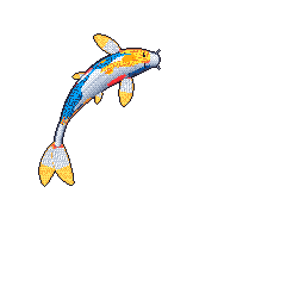

<!-- Every card is an animated SVG drawn by scripts/render_cards.py and refreshed daily by
     .github/workflows/profile-cards.yml. The koi is drawn nightly by git-koi
     (.github/workflows/koi.yml). Spacing is baked into the SVGs, so keep this block free of
     blank lines and keep cards in a row on one line with no spaces between them. -->

 
 
 
 
 
<picture><source media="(prefers-color-scheme: dark)" srcset="./cards/title-coding-dark.svg" /></picture> 
 
<picture><source media="(prefers-color-scheme: dark)" srcset="./cards/title-koi-dark.svg" /></picture> 
 
<picture><source media="(prefers-color-scheme: dark)" srcset="./cards/title-snake-dark.svg" /></picture> 
<picture><source media="(prefers-color-scheme: dark)" srcset="https://raw.githubusercontent.com/keshavop/keshavop/output/github-contribution-grid-snake-dark.svg" /></picture>

<a href="https://keshavop.vercel.app">keshavop.vercel.app</a> &nbsp;/&nbsp; <a href="https://www.linkedin.com/in/keshavop/">linkedin</a> &nbsp;/&nbsp; <a href="https://twitter.com/Keshavopdev">twitter</a> &nbsp;/&nbsp; <a href="https://www.instagram.com/keshav2op_">instagram</a>
 
<a href="https://www.leetcode.com/keshavop">leetcode</a> &nbsp;·&nbsp; <a href="https://codeforces.com/profile/keshavop">codeforces</a> &nbsp;·&nbsp; <a href="https://www.codechef.com/users/keshavop">codechef</a> &nbsp;·&nbsp; <a href="https://www.hackerrank.com/keshavop">hackerrank</a> &nbsp;·&nbsp; <a href="https://auth.geeksforgeeks.org/user/keshavop/profile">gfg</a> &nbsp;·&nbsp; <a href="https://www.hackerearth.com/@keshavop">hackerearth</a>

